# Style Grid for ComfyUI

Searchable, categorized visual card grid for browsing and applying prompt styles in ComfyUI. A ComfyUI node port of the [WebUI extension](https://github.com/KazeKaze93/sd-webui-style-organizer) with the same idea: search, favorites, presets, and a visual grid instead of a flat dropdown.

## Features

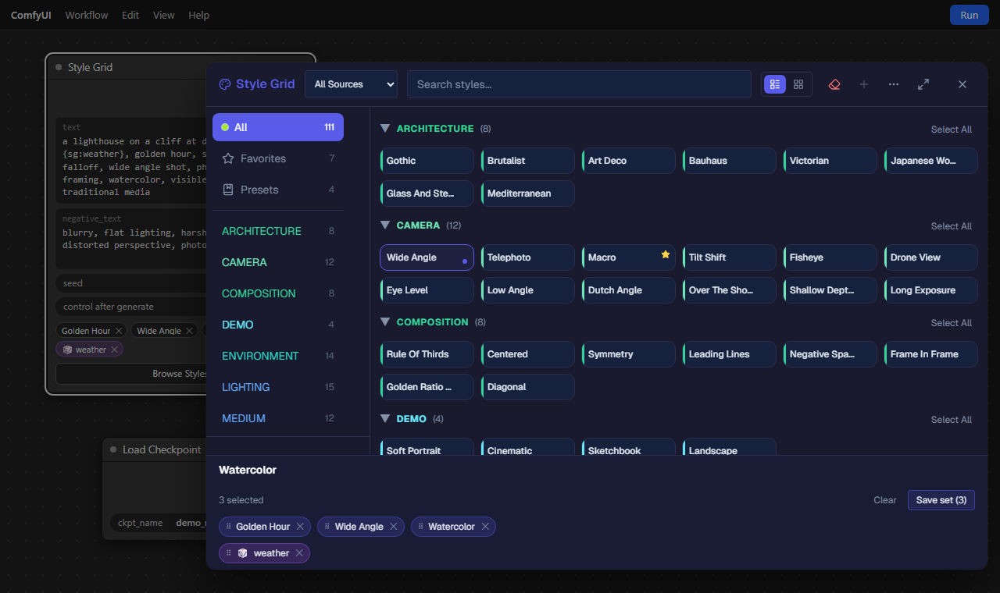

- Search and category filtering across your style packs
- Multi-select with conflict detection (per-pair **Remove** / **Keep both**)
- Grid and Gallery views; the gallery shows each style's preview image
- Favorites, saved on the server (`user/style_grid/favorites.json`)
- Presets as cards: save, apply, rename and delete groups of styles
- Create, edit (including rename), duplicate, move and delete styles from the panel
- Thumbnail previews by **upload** (Style Grid does not generate previews)
- Import and export styles and presets as JSON
- Backup & restore: zip snapshots under `user/style_grid/backups/`, restored from the panel
- Wildcard support: `{sg:category}` picks a random style from that category at node execution, driven by the node's **seed**; `{sg:category:spec}` limits the pool to a slice (include / exclude / glob). Shuffle wildcards `{sgd:category}` / `{sgd:category:spec}` draw without repeats, one step per queue run
- Keyboard shortcuts: `/` focuses search; Escape closes dialogs/menus, clears search, or closes the panel; arrow keys move in the grid; Enter/Space toggles the focused style
- Combos: styles can list related names in their description (`Combos: …`); the card shows clickable “Works with” chips to select those styles or jump to a category

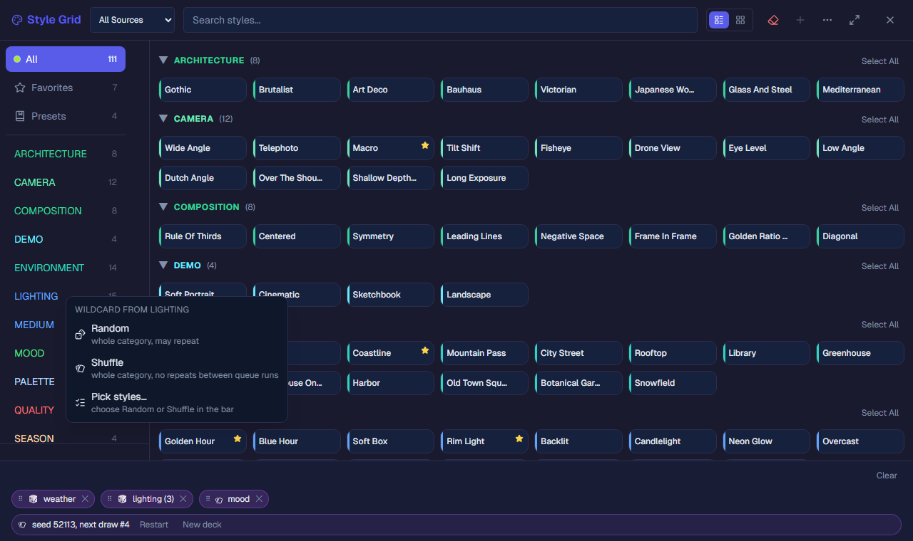

Right-click a category in the **sidebar** (or focus it and press Shift+F10) for its wildcard menu. While a category row is hovered or focused, the line at the bottom of the sidebar reads *CATEGORY: right-click for options*.

| Item | What it does |
|---|---|
| **Random** | Inserts `{sg:<category>}` (whole category, may repeat) into the node's text |
| **Shuffle** | Inserts `{sgd:<category>}` (whole category, no repeats between queue runs) |
| **Pick styles…** | Opens the slice bar over the grid: **Wildcard from CATEGORY**, a **Random / Shuffle** toggle and the picked count, then **Select all**, **Clear**, **Cancel** and **Add wildcard**. Tick styles (search and source filter still apply; **Select all** covers the visible list). **Add wildcard** inserts a compact `{sg:<category>:<spec>}` or `{sgd:<category>:<spec>}`; it stays disabled while nothing is picked |

**How `{sg:…}` works**

- **Whole category:** `{sg:body}` — category match is case-insensitive
- **Slice:** `{sg:body:Tanned,Shortstack}` — comma-separated **suffixes without the category prefix** (not `BODY_Tanned`). Leading `-` excludes (`{sg:body:-Tanned}`); trailing `*` is a prefix glob (`{sg:body:Male_*}`)
- **Resolution:** includes are unioned, then excludes subtract. A slice that matches no styles resolves to empty and the node shows a warning. The UI writes the shortest correct form; the resolver understands all forms
- **Chips:** each active `{sg:…}` appears as a chip in the selected bar. A slice chip shows the **resolved pool size** (how many styles the token can pick from), with those style names in the tooltip — not the number of raw spec entries
- **When / what:** expanded when the Style Grid node runs. A wildcard in the positive field (`pos`) pulls the style’s `prompt`; in the negative field (`neg`) it pulls `negative_prompt`
- **Seed:** the picks come from the node’s **seed** input. The same seed and text give the same picks: set it to `fixed` to repeat a result, keep `randomize` for new picks on every queue run. Workflows saved before the input existed load with `randomize`
- **The picked style’s negative comes along:** a wildcard in the positive field also adds that style’s `negative_prompt` to the negative output, after your negative text, in token order, then duplicates are merged. The same token in the negative field reuses the positive pick (the k-th occurrence pairs with the k-th one). A negative tag that also appears in the expanded positive is dropped and logged. This always runs
- **Nesting depth:** nested `{sg:…}` tokens resolve in up to **3** passes. Leftovers after that are stripped with a warning
- **Empty fields:** an empty chosen field resolves to an empty string (the token is not kept), on both the positive and negative sides
- **Source filter:** a specific CSV limits the pool to that pack; All Sources uses the merged library
- **Unknown / empty category:** the raw token is left in place through nested passes, then stripped with a warning

You can also type or paste `{sg:…}` tokens by hand.

**Shuffle wildcards `{sgd:…}`**

A shuffle wildcard draws styles **without repeats**. Where `{sg:category}` may pick the same style on consecutive runs, `{sgd:category}` uses every style in the category once before any style comes back.

- **Syntax:** `{sgd:category}` for a whole category, `{sgd:category:spec}` for a slice. The spec grammar is identical to `{sg:…}` (names, `-excludes`, `Prefix_*` globs), and the order of entries does not matter
- **Insert:** use the *shuffle* group of the category menu, or type the token by hand. Shuffle chips have their own icon and are removed and saved in presets like any other wildcard
- **One queue run, one draw:** the node resolves its text once per run, so every image of a single latent batch shares the same draw. To step through the deck, queue several runs (**Batch count** in the queue controls), not a larger batch size
- **Deck strip:** while a shuffle chip is active, the panel shows `seed N, next draw #M` next to the chips. **Restart** goes back to the first draw, **New deck** picks a new random seed and starts from the first draw. The position advances by itself after every queue run
- **Range:** a deck has up to 9,999 positions per seed. When you run out, press **New deck**
- **Several tokens:** repeating the same token in one prompt draws a different style for each occurrence
- **Positive and negative:** the same shuffle token in both fields resolves to the same style
- **Duplicates across packs:** styles with identical prompt and negative prompt count once
- **Random wildcards are separate.** `{sg:…}` follows the node’s **seed**, not the deck seed or position. Mixing `{sg:…}` and `{sgd:…}` in one prompt is fine, they do not influence each other
- **Presets:** shuffle chips are saved in presets and restored as shuffle chips
- **Existing workflows:** the deck seed and position are stored in two optional inputs that stay hidden on the node and are saved with the workflow. Workflows saved before load as before

- Works with multiple CSV sources at once, or filtered to one
- **Theme:** the panel follows the ComfyUI color palette (light / dark) automatically

## Installation

**Via ComfyUI-Manager (recommended):**

Open ComfyUI-Manager → Custom Nodes Manager → search "Style Grid" →
Install. Restart ComfyUI when prompted.

**Manual / development install:**

```bash
cd ComfyUI/custom_nodes
git clone https://github.com/KazeKaze93/sd-comfyui-style-organizer
```

Restart ComfyUI. The Style Grid node will be available under the node search.

Updates: Manager installs update through Manager's own Update /
Check for updates flow. Manual git installs update via `git pull`
inside the extension folder.

## Publishing to Comfy Registry

`comfy node publish` does **not** pick up `CHANGELOG.md` automatically. The registry **Updates** section is filled only if you pass changelog text:

```powershell
comfy node publish --changelog-file notes-<version>.md
```

(or `--changelog "..."` / `COMFY_NODE_CHANGELOG`). GitHub Release notes alone do not appear there. After bumping `pyproject.toml` and cutting `CHANGELOG.md`, publish with that flag; if a version was uploaded without it, delete the version on the registry and republish.

## Usage

Add the **Style Grid** node to your workflow. It outputs two STRING values, positive and negative, meant to feed directly into your text encode nodes. The negative output also carries the negative prompts of styles picked by wildcards in the positive text. Click **Browse Styles** to open the grid, search or browse by category, and apply styles to the node's text fields directly.

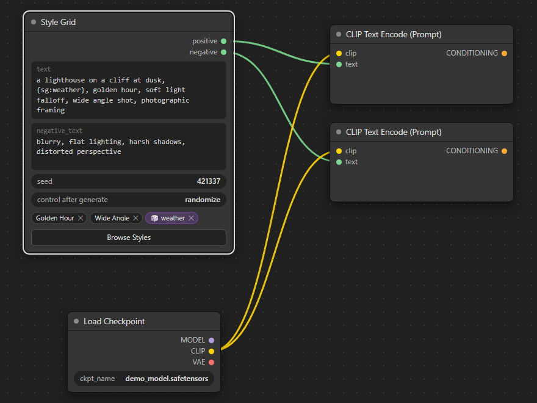

The two STRING outputs feed the text encode nodes' `text` inputs.
In current ComfyUI, drag a STRING output onto the text widget (or its
socket) to convert that widget into an input — you no longer need a
separate "Convert text to input" menu step.

## Working with styles

**Header** (one row): source filter, search, the **Grid / Gallery** toggle,
**Clear prompts and selection**, **New style** (needs a writable CSV
source), **⋯ More** (Import / Export…, Backup & restore…), fullscreen and
close. Toolbar tooltips open on hover or Tab focus.

**Clear prompts and selection** empties **both** text fields of the node
(`text` and `negative_text`) completely, your own text included, and
clears the selection, the active wildcards and the applied-styles record.

Applying a style keeps the first occurrence of a tag (and its weight) so unapply can restore the prompt exactly; at generation the node dedups weighted duplicates and keeps the highest weight, unless one occurrence is a de-emphasis (below 1.0), in which case the first occurrence wins.

**Conflicts:** when one selected style's negative prompt removes another
one's tags, a warning shows the count. Click it for the list of pairs;
each pair offers **Remove** for either style or **Keep both**.

Favorite styles show a **star**; selected tiles are highlighted.
Right-click a style card (or press Shift+F10) for Select/Deselect,
Add/Remove favorites, Copy prompt, Edit…, Duplicate, Move to category…,
Upload preview…, Remove preview (when one exists) and Delete…. In the
gallery, ★ and ⋯ also appear on the tile on hover. **Delete** asks for
confirmation first.

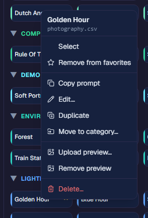

**Edit** changes the category, name, prompt, negative prompt, description
and its **Works with** chips. A changed name renames the CSV row in its
own file; the preview, favorites and presets follow. If the style is
applied on the node, the node text is updated to the saved version.

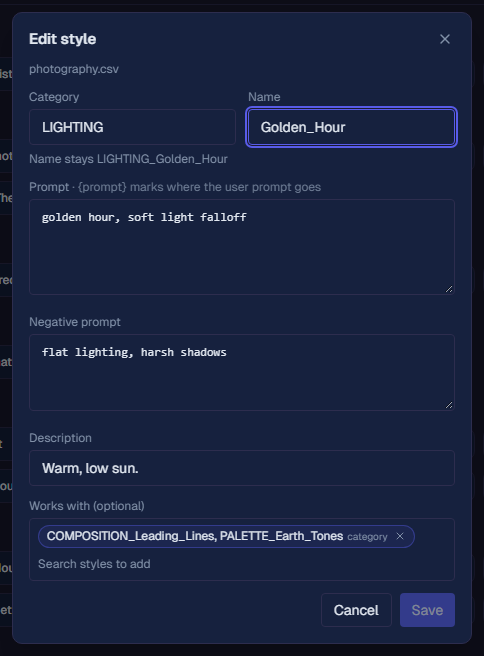

**Move to category** offers the existing categories.

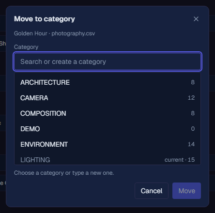

**Duplicate** works on any style. On a style from the read-only sample
pack it writes the copy to `user/style_grid/<same file>` and switches the
source filter there; **New style** while the samples source is active does
the same. Edit, Move and Delete are blocked on styles from `samples/`:

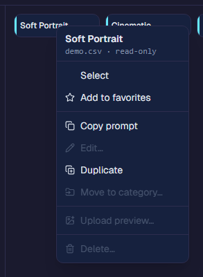

**Presets** show as cards in the **Presets** view: **Apply** merges a set
into your selection, an applied set offers **Remove**, and ⋯ renames or
deletes it. The last tile saves the current selection as a new set.

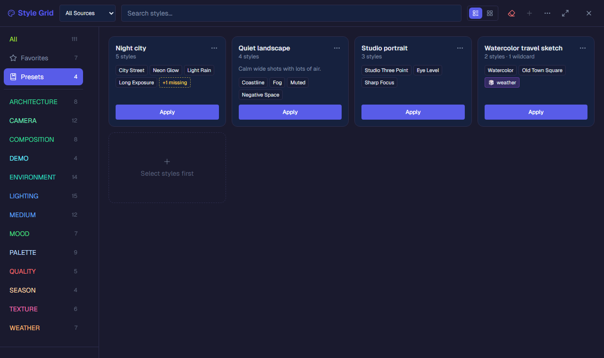

**Import / Export…** (⋯ More) exports styles and presets as JSON, and
imports that JSON or a backup zip. An imported style that is a true
duplicate (same name **and** identical prompt and negative prompt as a
style already in a pack, or earlier in the same file) is skipped and
listed; a style that shares a name but differs is imported. Re-importing
your own export therefore adds nothing. Imported styles go into a new
CSV under `user/style_grid/imports/`. An imported preset replaces a preset
of the same name.

**Backup & restore…** (⋯ More) lists the snapshots and creates new ones
(optionally with thumbnails). A snapshot holds your packs
(`user/style_grid/` and `imports/`), presets, favorites and the category
order; bundled `samples/` is never included. **Restore** shows what the
snapshot will put back, writes a safety snapshot of the current state
first, then replaces those files. The newest 20 snapshots are kept.

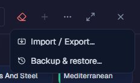

**Search** with autocomplete suggestions as you type. When nothing
matches, or a view is empty (no favorites, no presets, no styles yet),
the grid says why and offers the next step (clear the search, show all
categories, import a CSV…).

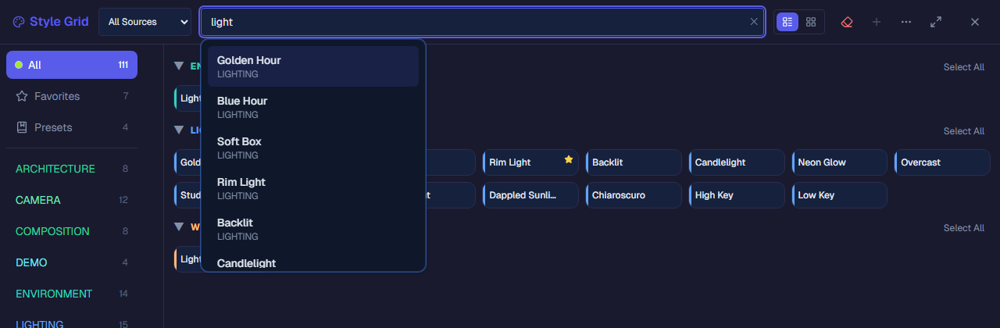

**Thumbnails:** upload one from the card menu (**Upload preview…**); the
**Gallery** view shows them. Style Grid does not generate previews. Preview
files are keyed by **style name + source CSV**, so the same UNIVERSAL name in two packs keeps independent previews. Older name-only files migrate when the name maps to one pack, or when every pack that shares the name has **byte-identical** `prompt` and `negative_prompt`. If the same name appears in multiple packs with **diverging** content, upload each preview again.

**Favorites** are stored on the server. Favorites kept in the browser by
older versions are moved there once, on the first open.

The panel supports fullscreen for browsing large packs:

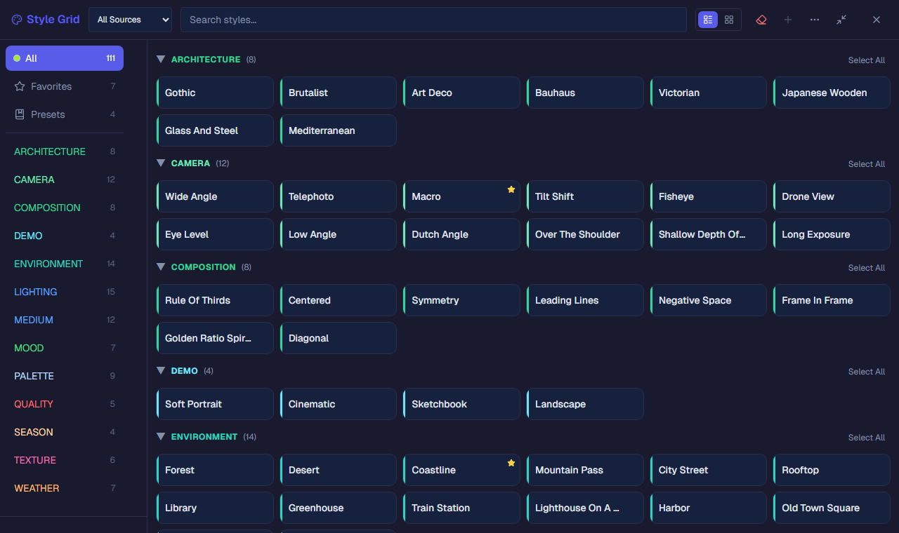

## Style packs

Style Grid ships with one small sample pack (`demo.csv`) so the grid isn't empty on first install. Full style packs are distributed separately on [CivitAI](https://civitai.com/models/2409619/sfw-prompt-pack). Drop CSV files into ComfyUI's `user/style_grid/` folder to add more. Do not put the same CSV file in both `user/style_grid/` and `user/style_grid/imports/`: each copy loads as a separate source, so every style in it appears twice.

## BREAK and prompt chunking

Style Grid does not insert or manage `BREAK` tokens itself. If your styles or prompts use `BREAK`, ComfyUI's built-in CLIP Text Encode node treats it as a literal word rather than a chunk separator. Use a BREAK-aware text encoder such as [CLIPTextEncodeBREAK](https://github.com/pamparamm/ComfyUI-ppm) if you rely on BREAK in your prompts.

## Generated files and cleanup

> **Data survives reinstall since this version.** User CSVs, presets,
> thumbnails, and backups live under ComfyUI's user directory
> (`user/style_grid/`), not inside the extension folder. Uninstalling or
> reinstalling the node via ComfyUI-Manager no longer wipes that data.

Style Grid writes runtime data under ComfyUI's
`folder_paths.get_user_directory()/style_grid`
(typically `ComfyUI/user/style_grid/`):

| Path | What it is | Safe to delete? |
|------|-----------|------------------|
| `user/style_grid/*.csv` | Your own style packs (created via New style, or Duplicate/Move/Edit on non-protected styles) | Only if you don't need them — this is your data |
| `user/style_grid/imports/*.csv` | Style packs created by the Import feature (including restore from a Backup zip) | Yes, anytime |
| `user/style_grid/backups/` | Backup snapshots (`.zip`: packs, `presets.json`, `favorites.json`, `category_order.json`, optionally thumbnails), including the `_safety` snapshot written before each restore. Oldest auto-pruned past 20 | Yes |
| `user/style_grid/presets.json` | Saved presets. Corrupt/unreadable JSON returns HTTP **409** and is not overwritten — restore from sibling `.bak` (atomic writes keep `.bak` / `.bak.2` / `.bak.3`). | Only if you don't need them |
| `user/style_grid/favorites.json` | Favorite styles (`<source>` + name keys) | Only if you don't need them |
| `user/style_grid/category_order.json` | Persisted sidebar category order | Yes — order falls back to defaults |
| `user/style_grid/thumbnails/` | Uploaded preview images | Yes, previews just won't show until re-uploaded |

**Migration from older installs:** On first startup, if `user/style_grid/`
is empty and the extension still has files under its legacy `data/`
folder, Style Grid **copies** (never moves) that content into the new
location and writes a marker file. The old `data/` folder inside the
extension is **not** auto-deleted — remove it yourself once you confirm
the copy looks right. CSVs placed in the extension's `data/` folder are not loaded; Style Grid logs a startup warning when that folder holds CSVs missing from or different to `user/style_grid/`.

`samples/demo.csv` (the bundled demo pack) stays inside the extension and
is read-only by design — Edit, Move, and Delete are blocked on styles from
this file. Duplicate a style (or create one while the samples source is
active) to get an editable copy in `user/style_grid/demo.csv`.

## Security note

Mutating `/style_grid/*` HTTP routes have **no authentication**. If you
run ComfyUI with `--listen` (or otherwise bind it beyond localhost),
those endpoints are reachable from the network — the same trust model
as ComfyUI itself. Do not expose ComfyUI to untrusted networks.

## Development

Quality checks run locally via a Git `pre-push` hook (no GitHub Actions CI).

After clone, enable repo hooks once:

```bash
git config core.hooksPath .githooks
```

`pre-push` runs an EOL guard (no CRLF in the index/working tree text files, no CR bytes in committed `web/ui`), then pytest (pinned minimum pass count), UI typecheck/lint/vitest (pinned minimum), then `npm run build` in `ui/` and fails if `web/ui` differs (`git diff --exit-code -- web/ui`).

```bash
# Python (from repo root; needs pytest)
python scripts/run_pytest_min.py

# UI (from ui/)
npm ci
npm test
npx tsc --noEmit -p tsconfig.app.json
npx tsc --noEmit -p tsconfig.node.json
npx tsc --noEmit -p tsconfig.test.json
npm run lint

# Rebuild the committed panel bundle into web/ui/
npm run build
git diff --exit-code -- web/ui
```

## License

AGPL-3.0. See [LICENSE](LICENSE).
