# Style Grid for ComfyUI

Searchable, categorized visual card grid for browsing and applying prompt styles in ComfyUI. A ComfyUI node port of the [WebUI extension](https://github.com/KazeKaze93/sd-webui-style-organizer) with the same idea: search, favorites, presets, and a visual grid instead of a flat dropdown.

## Features

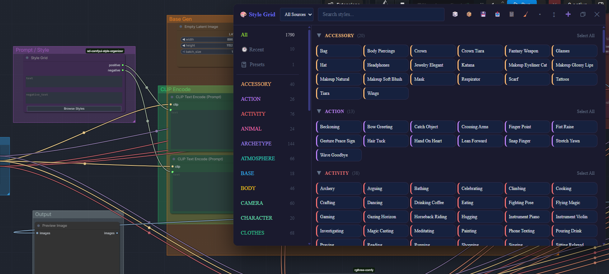

- Search and category filtering across your style packs
- Multi-select with conflict detection
- Favorites and recently used
- Presets: save and load groups of styles at once
- Create, edit, duplicate, and delete styles from the grid
- Move styles between categories
- Thumbnail previews with manual upload
- Import and export styles and presets as JSON
- Manual Backup: zip snapshot of user-dir CSVs + presets under `user/style_grid/backups/`
- Wildcard support: `{sg:category}` picks a random style from that category at node execution, driven by the node's **seed**; `{sg:category:spec}` limits the pool to a slice (include / exclude / glob). Shuffle wildcards `{sgd:category}` / `{sgd:category:spec}` draw without repeats, one step per queue run
- Keyboard shortcuts: `/` focuses search; Escape closes dialogs/menus, clears search, or closes the panel; arrow keys move in the grid; Enter/Space toggles the focused style
- Combos: styles can list related names in their description (`Combos: …`); the card shows clickable “Works with” chips to select those styles or jump to a category

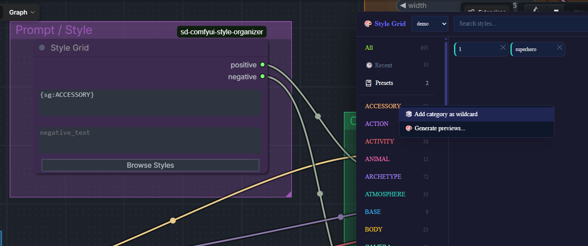

Right-click a category in the **sidebar** for wildcard actions, in two groups: **random** (`{sg:…}`, can repeat) and **shuffle** (`{sgd:…}`, no repeats between queue runs):

| Item | What it does |
|---|---|
| **Whole category** (random) | Inserts `{sg:<category>}` into the active text field |
| **Pick styles…** (random) | Opens slice-selection mode: tick styles (search and source filter still apply; **Select all** covers the currently visible list). **Add as wildcard** inserts a compact `{sg:<category>:<spec>}` for that selection |
| **Whole category** (shuffle) | Inserts `{sgd:<category>}` |
| **Pick styles…** (shuffle) | Same slice selection, but **Add as shuffle wildcard** inserts `{sgd:<category>:<spec>}` |

**How `{sg:…}` works**

- **Whole category:** `{sg:body}` — category match is case-insensitive
- **Slice:** `{sg:body:Tanned,Shortstack}` — comma-separated **suffixes without the category prefix** (not `BODY_Tanned`). Leading `-` excludes (`{sg:body:-Tanned}`); trailing `*` is a prefix glob (`{sg:body:Male_*}`)
- **Resolution:** includes are unioned, then excludes subtract. If every listed name is missing, the token **falls back to the whole category** instead of vanishing. The UI writes the shortest correct form; the resolver understands all forms
- **Chips:** each active `{sg:…}` appears as a chip in the selected bar. A slice chip shows the **resolved pool size** (how many styles the token can pick from), with those style names in the tooltip — not the number of raw spec entries
- **When / what:** expanded when the Style Grid node runs. A wildcard in the positive field (`pos`) pulls the style’s `prompt`; in the negative field (`neg`) it pulls `negative_prompt`
- **Seed:** the picks come from the node’s **seed** input. The same seed and text give the same picks: set it to `fixed` to repeat a result, keep `randomize` for new picks on every queue run. Workflows saved before the input existed load with `randomize`
- **The picked style’s negative comes along:** a wildcard in the positive field also adds that style’s `negative_prompt` to the negative output, after your negative text, in token order, then duplicates are merged. The same token in the negative field reuses the positive pick (the k-th occurrence pairs with the k-th one). A negative tag that also appears in the expanded positive is dropped and logged. This always runs
- **Nesting depth:** nested `{sg:…}` tokens resolve in up to **3** passes. Leftovers after that are stripped with a warning
- **Empty fields:** an empty chosen field resolves to an empty string (the token is not kept), on both the positive and negative sides
- **Source filter:** a specific CSV limits the pool to that pack; All Sources uses the merged library
- **Unknown / empty category:** the raw token is left in place through nested passes, then stripped with a warning

You can also type or paste `{sg:…}` tokens by hand.

**Shuffle wildcards `{sgd:…}`**

A shuffle wildcard draws styles **without repeats**. Where `{sg:category}` may pick the same style on consecutive runs, `{sgd:category}` uses every style in the category once before any style comes back.

- **Syntax:** `{sgd:category}` for a whole category, `{sgd:category:spec}` for a slice. The spec grammar is identical to `{sg:…}` (names, `-excludes`, `Prefix_*` globs), and the order of entries does not matter
- **Insert:** use the *shuffle* group of the category menu, or type the token by hand. Shuffle chips have their own icon and are removed and saved in presets like any other wildcard
- **One queue run, one draw:** the node resolves its text once per run, so every image of a single latent batch shares the same draw. To step through the deck, queue several runs (**Batch count** in the queue controls), not a larger batch size
- **Deck strip:** while a shuffle chip is active, the panel shows `seed N, next draw #M` next to the chips. **Restart** goes back to the first draw, **New deck** picks a new random seed and starts from the first draw. The position advances by itself after every queue run
- **Range:** a deck has up to 9,999 positions per seed. When you run out, press **New deck**
- **Several tokens:** repeating the same token in one prompt draws a different style for each occurrence
- **Positive and negative:** the same shuffle token in both fields resolves to the same style
- **Duplicates across packs:** styles with identical prompt and negative prompt count once
- **Random wildcards are separate.** `{sg:…}` follows the node’s **seed**, not the deck seed or position. Mixing `{sg:…}` and `{sgd:…}` in one prompt is fine, they do not influence each other
- **Presets:** shuffle chips are saved in presets and restored as shuffle chips
- **Existing workflows:** the deck seed and position are stored in two optional inputs that stay hidden on the node and are saved with the workflow. Workflows saved before load as before

- Works with multiple CSV sources at once, or filtered to one
- **Theme:** the panel follows the ComfyUI color palette (light / dark) automatically

## Installation

**Via ComfyUI-Manager (recommended):**

Open ComfyUI-Manager → Custom Nodes Manager → search "Style Grid" →
Install. Restart ComfyUI when prompted.

**Manual / development install:**

```bash
cd ComfyUI/custom_nodes
git clone https://github.com/KazeKaze93/sd-comfyui-style-organizer
```

Restart ComfyUI. The Style Grid node will be available under the node search.

Updates: Manager installs update through Manager's own Update /
Check for updates flow. Manual git installs update via `git pull`
inside the extension folder.

## Publishing to Comfy Registry

`comfy node publish` does **not** pick up `CHANGELOG.md` automatically. The registry **Updates** section is filled only if you pass changelog text:

```powershell
comfy node publish --changelog-file notes-<version>.md
```

(or `--changelog "..."` / `COMFY_NODE_CHANGELOG`). GitHub Release notes alone do not appear there. After bumping `pyproject.toml` and cutting `CHANGELOG.md`, publish with that flag; if a version was uploaded without it, delete the version on the registry and republish.

## Usage

Add the **Style Grid** node to your workflow. It outputs two STRING values, positive and negative, meant to feed directly into your text encode nodes. The negative output also carries the negative prompts of styles picked by wildcards in the positive text. Click **Browse Styles** to open the grid, search or browse by category, and apply styles to the node's text fields directly.

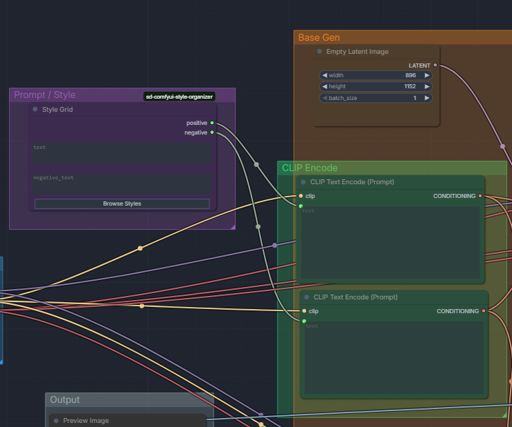

The two STRING outputs feed the text encode nodes' `text` inputs.
In current ComfyUI, drag a STRING output onto the text widget (or its
socket) to convert that widget into an input — you no longer need a
separate "Convert text to input" menu step.

## Working with styles

The toolbar (icon buttons with tooltips) includes **Backup**,
**Import/Export**, **Clear all selected styles**, **Compact mode**,
**Expand/Collapse all**, **New style** (needs a writable CSV source),
fullscreen, and close. When multi-select finds conflicts, a red warning
badge with a count appears — **click** it to open a popover listing each
conflict; you can remove the conflicting style from there.
Applying a style keeps the first occurrence of a tag (and its weight) so
unapply can restore the prompt exactly; at generation the node dedups
weighted duplicates and keeps the highest non-negative weight.

Favorite styles show a **star** on the tile; selected styles show a
**check** badge. Right-click any style card for Select/Deselect, Add/Remove
Favorites, Copy prompt, Edit, Duplicate, Move to category, Upload preview
image, Delete preview (when one exists), and Delete. **Delete** asks for
confirmation in a dialog before removing the CSV row.

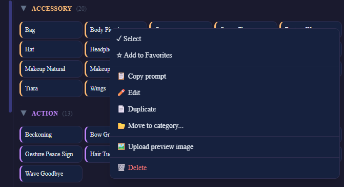

**Edit** opens a form for the style's description, category, prompt,
and negative prompt (the name itself isn't editable here — renaming is
Duplicate-then-delete-the-original, kept separate to avoid orphaning
CSV rows).

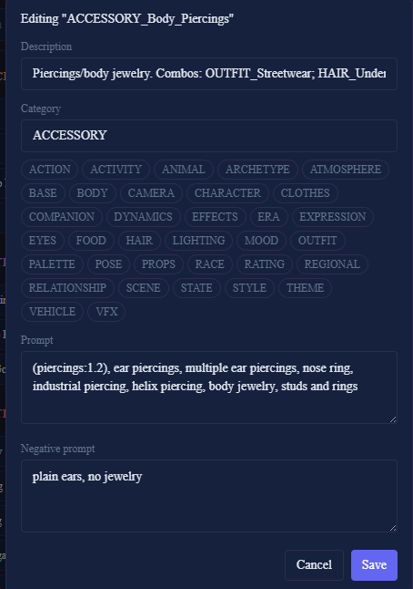

**Move to category** offers existing categories as quick-pick chips.

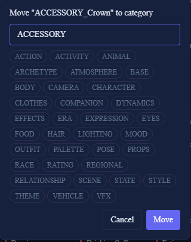

**Duplicate** works on any style, including ones from the read-only
sample pack — it's the way to turn a demo style into your own editable
copy. Edit, Move, and Delete are blocked on styles from `samples/`:

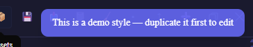

**Presets** let you save and reload a set of selected styles at once.
Clicking an already-loaded preset unloads it.

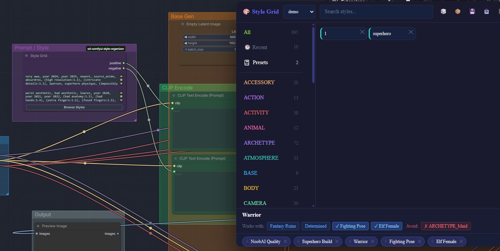

**Import/Export** (toolbar import icon) opens a small menu with
**Export** and **Import from file…**. Export downloads styles and presets
as JSON. Import accepts that JSON, or a Backup zip
(CSVs + presets). Importing a preset whose name already exists
**overwrites** the existing preset with the imported definition.

**Backup** (toolbar save icon) writes a manual zip snapshot of your
user-dir CSVs (`style_grid/` and `style_grid/imports/`) plus `presets.json`
into `style_grid/backups/` (bundled `samples/` is excluded). It is not
automatic, and it is separate from Export.

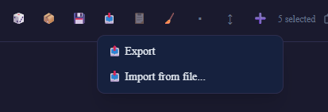

**Search** with autocomplete suggestions as you type:

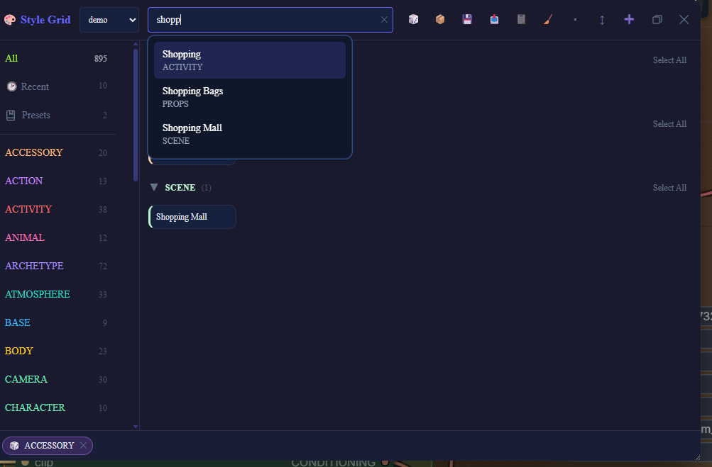

**Thumbnails** show on hover once uploaded via the card menu. Preview files are keyed by **style name + source CSV**, so the same UNIVERSAL name in two packs keeps independent previews. Older name-only files migrate when the name maps to one pack, or when every pack that shares the name has **byte-identical** `prompt` and `negative_prompt`. If the same name appears in multiple packs with **diverging** content, regenerate each preview.

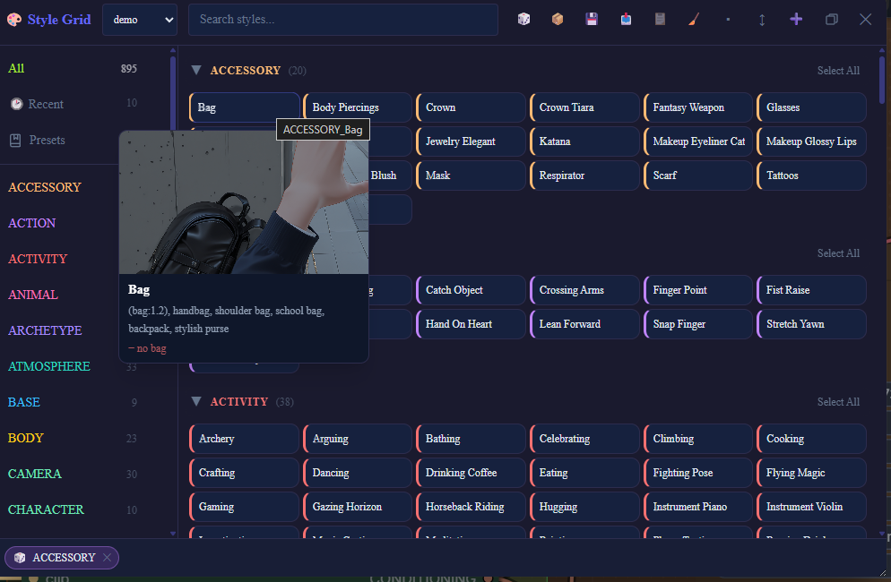

The panel supports fullscreen for browsing large packs:

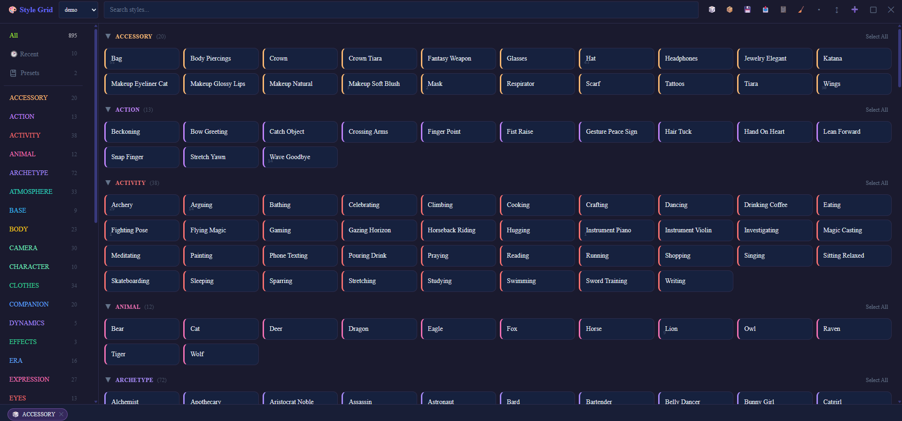

## Style packs

Style Grid ships with one small sample pack (`demo.csv`) so the grid isn't empty on first install. Full style packs are distributed separately on [CivitAI](https://civitai.com/models/2409619/sfw-prompt-pack). Drop CSV files into ComfyUI's `user/style_grid/` folder to add more. Do not put the same CSV file in both `user/style_grid/` and `user/style_grid/imports/`: each copy loads as a separate source, so every style in it appears twice.

## BREAK and prompt chunking

Style Grid does not insert or manage `BREAK` tokens itself. If your styles or prompts use `BREAK`, ComfyUI's built-in CLIP Text Encode node treats it as a literal word rather than a chunk separator. Use a BREAK-aware text encoder such as [CLIPTextEncodeBREAK](https://github.com/pamparamm/ComfyUI-ppm) if you rely on BREAK in your prompts.

## Generated files and cleanup

> **Data survives reinstall since this version.** User CSVs, presets,
> thumbnails, and backups live under ComfyUI's user directory
> (`user/style_grid/`), not inside the extension folder. Uninstalling or
> reinstalling the node via ComfyUI-Manager no longer wipes that data.

Style Grid writes runtime data under ComfyUI's
`folder_paths.get_user_directory()/style_grid`
(typically `ComfyUI/user/style_grid/`):

| Path | What it is | Safe to delete? |
|------|-----------|------------------|
| `user/style_grid/*.csv` | Your own style packs (created via New style, or Duplicate/Move/Edit on non-protected styles) | Only if you don't need them — this is your data |
| `user/style_grid/imports/*.csv` | Style packs created by the Import feature (including restore from a Backup zip) | Yes, anytime |
| `user/style_grid/backups/` | Manual Backup `.zip` archives (CSVs + `presets.json`; Backup button). Oldest auto-pruned past 20 | Yes |
| `user/style_grid/presets.json` | Saved presets. Corrupt/unreadable JSON returns HTTP **409** and is not overwritten — restore from sibling `.bak` (atomic writes keep `.bak` / `.bak.2` / `.bak.3`). | Only if you don't need them |
| `user/style_grid/category_order.json` | Persisted sidebar category order | Yes — order falls back to defaults |
| `user/style_grid/thumbnails/` | Uploaded preview images | Yes, previews just won't show until re-uploaded |

**Migration from older installs:** On first startup, if `user/style_grid/`
is empty and the extension still has files under its legacy `data/`
folder, Style Grid **copies** (never moves) that content into the new
location and writes a marker file. The old `data/` folder inside the
extension is **not** auto-deleted — remove it yourself once you confirm
the copy looks right. CSVs placed in the extension's `data/` folder are not loaded; Style Grid logs a startup warning when that folder holds CSVs missing from or different to `user/style_grid/`.

`samples/demo.csv` (the bundled demo pack) stays inside the extension and
is read-only by design — Edit, Move, and Delete are blocked on styles from
this file. Use Duplicate to create an editable copy in `user/style_grid/`
first.

## Security note

Mutating `/style_grid/*` HTTP routes have **no authentication**. If you
run ComfyUI with `--listen` (or otherwise bind it beyond localhost),
those endpoints are reachable from the network — the same trust model
as ComfyUI itself. Do not expose ComfyUI to untrusted networks.

## Development

Quality checks run locally via a Git `pre-push` hook (no GitHub Actions CI).

After clone, enable repo hooks once:

```bash
git config core.hooksPath .githooks
```

`pre-push` runs an EOL guard (no CRLF in the index/working tree text files, no CR bytes in committed `web/ui`), then pytest (pinned minimum pass count), UI typecheck/lint/vitest (pinned minimum), then `npm run build` in `ui/` and fails if `web/ui` differs (`git diff --exit-code -- web/ui`).

```bash
# Python (from repo root; needs pytest)
python scripts/run_pytest_min.py

# UI (from ui/)
npm ci
npm test
npx tsc --noEmit -p tsconfig.app.json
npx tsc --noEmit -p tsconfig.node.json
npx tsc --noEmit -p tsconfig.test.json
npm run lint

# Rebuild the committed panel bundle into web/ui/
npm run build
git diff --exit-code -- web/ui
```

## License

AGPL-3.0. See [LICENSE](LICENSE).
