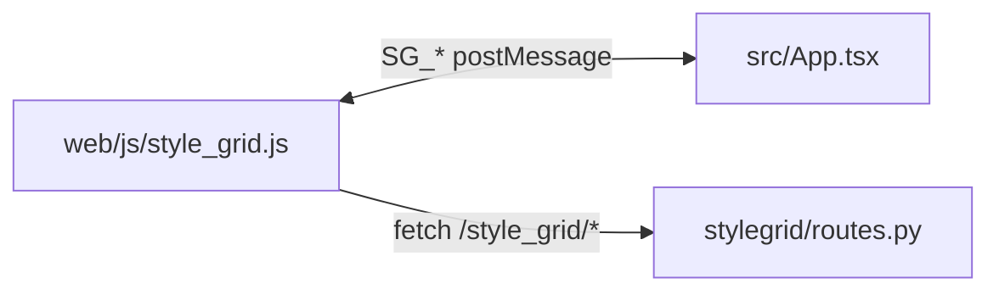

# Style Grid UI (V2)

React + TypeScript + Vite frontend for the ComfyUI Style Grid node. Built assets are served by ComfyUI’s extension web directory and loaded in an iframe.

## Commands

```bash
cd ui
npm install
npm run build
```

`npm run build` writes into **`../web/ui`** (`vite.config.ts` `build.outDir`). ComfyUI exposes that tree via `WEB_DIRECTORY = "./web"` in the package `__init__.py`, so the panel is available at `/extensions/sd-comfyui-style-organizer/ui/…`. The host script sets the iframe to `IFRAME_SRC` (`/extensions/sd-comfyui-style-organizer/ui/index.html`) with a cache-busting `?t=` query in `web/js/style_grid.js`.

## Key Files

- `src/App.tsx`: top-level layout and toolbar actions.
- `src/store/stylesStore.ts`: Zustand state, actions, `categories()`, and exported pure **`selectFilteredStyles(...)`** (filtered + deduped list for the grid — not a store method).
- `src/bridge.ts`: typed SG_* postMessage contract with host.
- `src/components/StyleGrid.tsx`: main grid; subscribes with **`useShallow`** and **`useMemo(selectFilteredStyles(...))`**; sidebar **Presets** view renders preset names with `StyleCard` (`presetName` + `SG_LOAD_PRESET`).
- `src/components/Sidebar.tsx`: category list; **`useShallow`** subscription to limit re-renders.
- `src/components/StyleCard.tsx` / `ThumbnailPreview.tsx`: style tiles; optional `presetName` disables context menu, usage chip, and hover thumbnail preview.
- `src/components/*`: other UI (sidebar, modals, etc.).

## Integration Flow



Thumbnail **images** use `GET /style_grid/thumbnail?name=…` (and optional `source`). Previews are uploaded with `POST /style_grid/thumbnail/upload` from the card menu; there is no generate-from-sampler path in this package.
